# Claude Code Kit for Mac (CCKit)

<p align="center">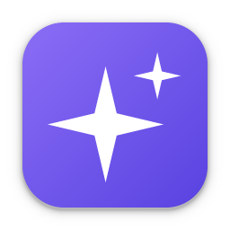</p>

**[Claude Code](https://claude.ai/code) CLI 의 주요 명령·작업을 macOS 메뉴바 패널에서 클릭 한 번에 조작**

터미널에서 `/remote-control`, `/bg`, `/rename`, `claude --resume`, `claude agents` 같은 명령을 일일이 치는 대신 - 메뉴바에 상주하는 컨트롤 패널에서 세션을 **열고·닫고·관리하고, 백그라운드로 보내고, 폰/웹에서 원격 조종**할 수 있습니다.

Windows 판 → [Claude Code Kit](https://github.com/hull-kr/Claude-Code-Kit)

<br>

<p align="center">
  <b>⬇️ 설치 - 터미널에 한 줄</b><br>
  <code>curl -fsSL https://github.com/hull-kr/Claude-Code-Kit-Mac/releases/latest/download/install.sh | bash</code>
</p>

<br>

<p align="center">
  <b>🗑️ 삭제 - 터미널에 한 줄</b><br>
  <code>curl -fsSL https://github.com/hull-kr/Claude-Code-Kit-Mac/releases/latest/download/uninstall.sh | bash</code>
</p>

<br>

<p align="center">
  macOS 12 이상 &nbsp;&nbsp;·&nbsp;&nbsp; Apple Silicon · Intel &nbsp;&nbsp;·&nbsp;&nbsp; 무료(Freeware)
</p>

<br>

<p align="center">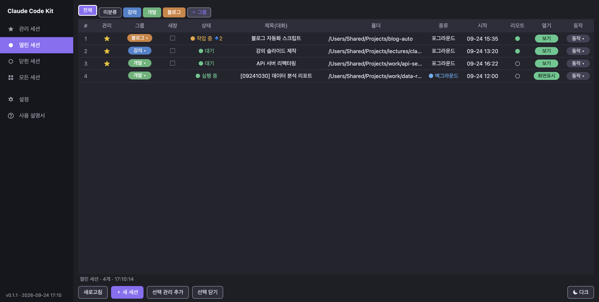</p>
<p align="center">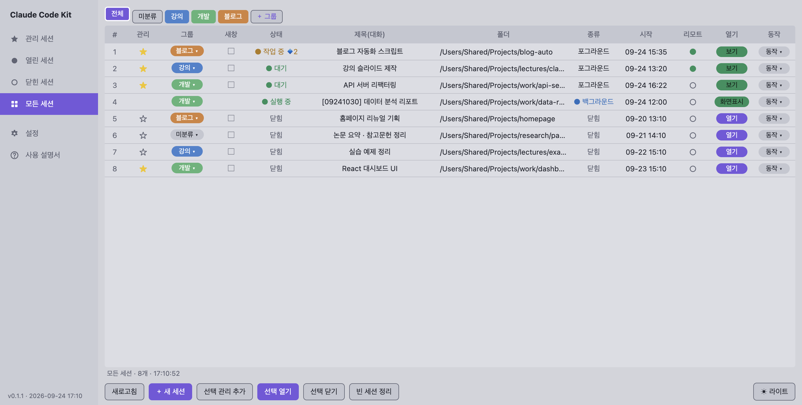</p>

---

## 🎛️ CLI 명령 ↔ UI 매핑

터미널에서 치던 것을 패널 버튼으로:

| Claude Code CLI | CCKit 패널 |
|---|---|
| `claude` (새 세션) | **＋ 새 세션** 버튼 (폴더·이름·그룹·원격·관리 옵션) |
| `claude --resume <id>` | 닫힌 세션 **열기** / **전체 이어서 열기** |
| `/remote-control` | 세션의 **리모트** 토글 (닫힌 세션도 바로 리모트로 열기) |
| `/bg` (백그라운드) | **bg 전환** |
| `/rename` | **제목 칸 더블클릭** |
| `claude agents` | 상태칸 **🔹N 뱃지 → 클릭** (서브에이전트 목록) |
| `claude attach <id>` | 백그라운드 **화면표시** / **화면닫기** |
| `claude stop` / `rm` | 백그라운드 **세션 닫기** |
| 이미지 경로 입력 | **⌃⇧V** (클립보드 이미지 자동 저장·경로 입력) |
| `.claude/settings.local.json` 의 `env` 를 손으로 고쳐 다른 회사 모델 연결 | 세션 우클릭 → **타사 API 설정 (베타)** |

> ℹ️ **`ccd`** 는 Claude 순정 명령이 아니라 **CCKit 이 추가하는 단축 명령**입니다 (`ccd = claude --dangerously-skip-permissions`). 아래 [ccd 단축 명령](#️-ccd-단축-명령) 참고.

---

## 📥 설치

1. **터미널**(응용 프로그램 → 유틸리티 → 터미널, 또는 ⌘+Space 로 "터미널" 검색)을 엽니다.
2. 아래 한 줄을 붙여 넣고 Enter:
   ```bash
   curl -fsSL https://github.com/hull-kr/Claude-Code-Kit-Mac/releases/latest/download/install.sh | bash
   ```
   ```
   ▶ 내려받는 중 (arm64): https://github.com/hull-kr/Claude-Code-Kit-Mac/releases/latest/download/CCKit-mac-arm64.zip
   ▶ 압축 푸는 중
   ▶ 설치: /Applications/Claude Code Kit.app
   ▶ 실행

   ✅ 설치 완료 - 화면 오른쪽 위 메뉴바의 ✦ 아이콘을 누르세요.
   ```
3. 화면 **오른쪽 위 메뉴바의 ✦ 아이콘** → **컨트롤 패널**.
4. 처음 세션을 열 때 **"Claude Code Kit 이 Terminal 을 제어하려고 합니다"** → **[허용]**.
   세션 열기·닫기·리모트·이름 바꾸기가 터미널에 명령을 넣는 방식이라 꼭 필요합니다.

- 앱은 **`/Applications/Claude Code Kit.app`**(Finder → 응용 프로그램)에 설치됩니다. **Dock 에 고정**하려면 응용 프로그램 폴더에서 Dock 으로 끌어다 놓으세요.
- 같은 명령을 다시 실행하면 **최신 버전으로 업데이트**됩니다 (앱 안 **설정 → 업데이트 → 지금 업데이트** 도 가능).
- Apple Silicon(M1~) · Intel 은 자동으로 골라 받습니다.

> **왜 .dmg 대신 한 줄 설치인가요?**
> 이 프로그램은 **무료라 Apple 유료 개발자 서명·공증을 하지 않았습니다.** 브라우저로 받은 앱은 macOS 가 "확인할 수 없는 개발자" 로 막고,
> 최신 macOS 에서는 우클릭 → 열기로도 열리지 않습니다. **터미널로 받으면 이 경고 없이 설치됩니다.**
> .dmg 도 [릴리즈](https://github.com/hull-kr/Claude-Code-Kit-Mac/releases/latest)에 있지만, 그걸 쓰면 설치 후
> **시스템 설정 → 개인정보 보호 및 보안 → "그래도 열기"** 를 누르고 암호를 넣어야 합니다.

### 🧩 선행 프로그램 확인·설치

설정의 **선행 프로그램** 에서 **Node.js · Python · Git · Claude Code** 의 **설치 여부 · 버전 · 최신판인지**를 한눈에 보고, 버튼 하나로 설치/재설치합니다.

- **공식 배포처**로 설치합니다 - Node.js · Python · Git 은 **Homebrew**, Claude Code 는 **Anthropic 공식 설치 스크립트**
- 최신판은 `nodejs.org` · `python.org` · Git 릴리즈 · npm 에서 자동으로 확인
- Homebrew 가 없으면 먼저 Homebrew 를 설치합니다
- 설치는 **터미널 창에서 진행**돼 진행 상황이 보이고, 암호를 물으면 Mac 로그인 암호를 입력하면 됩니다

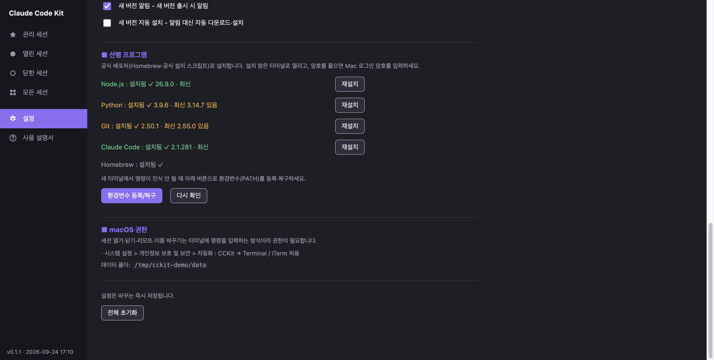

> 💡 **Claude Code 가 없어도 괜찮습니다.** 설정 → 선행 프로그램 → Claude Code **[설치]** 한 번이면 됩니다.

### 명령이 인식되지 않을 때

`claude` · `node` 명령을 못 찾는다고 나오면 **터미널을 닫고 새로 여세요.** 그래도 안 되면 **설정 → `환경변수 등록/복구`** -
Homebrew 와 `~/.local/bin`(claude 설치 위치)을 `~/.zprofile` 에 등록합니다 (기존 파일은 백업).

---

## ⭐ 주요 기능 요약

| 기능 | 한 줄 요약 |
|---|---|
| 🖼️ **이미지 붙여넣기** | `⌃⇧V` 로 클립보드 이미지 저장 + 경로 자동 입력 |
| 🗂️ **컨트롤 패널** | 세션 열기·닫기·관리, 상태 색, 그룹, 다중 선택, 정렬, 다크/라이트 |
| 🖱️ **우클릭 메뉴** | 세션 하나로 할 수 있는 모든 것(재시작·리모트·관리·bg 전환·이름 변경 등)을 그룹으로 |
| ➕ **새 세션** | 폴더·이름·그룹·원격·관리 옵션으로 새 세션 한 번에 생성 |
| 🌙 **bg 전환** | 실행 중 세션을 백그라운드로 (창 닫고 계속 실행) |
| 📱 **리모트 컨트롤** | 폰/웹(claude.ai/code)에서 이 Mac 세션 조종 |
| 🔹 **서브에이전트 표시** | 상태칸 `🔹N` → 클릭 시 작업 중 에이전트 목록 |
| ★ **관리 / 이어서 열기** | 즐겨찾기 세션 + 한 번에 복원 |
| 🏷️ **그룹** | 강의·개발처럼 세션을 묶고 탭으로 걸러 보기 |
| 🗓️ **세션 보관 기간** | Claude Code 가 오래된 대화를 지우는 기간 확인·변경, 지워진 세션은 `기간만료` 로 표시 |
| 🔑 **로그인 확인** | 구독 로그인을 막는 API 키(셸 환경변수·settings.json) 확인·비우기 + 구독 로그인 상태 + 버튼 하나로 `/login` |
| 🌐 **타사 API 설정 (베타)** | OpenRouter 키로 다른 회사 모델(예: `openai/gpt-5.6-luna`)을 **폴더(프로젝트)별로만** 연결·해제 - 전역 설정은 안 건드림 |
| 🔄 **재부팅 자동 복원** | 로그인 시 재부팅 직전 세션 자동 복원 |
| 🧩 **선행 프로그램** | Node.js·Python·Git·Claude Code 확인·설치·최신판 비교 |
| 🔔 **업데이트** | 새 버전 알림 · 앱 안에서 바로 업데이트 |
| 🌐 **다국어** | 한국어 / English / 日本語 / 中文 |

---

## ✨ 기능 상세

### 🖼️ 이미지 붙여넣기
캡처 후 터미널에서 **`⌃`+`⇧`+`V`** → 방금 찍은 이미지가 **그 세션 폴더의 `.tmp/clipboard/`** 에 저장되고, 그 경로가 입력칸에 자동으로 들어갑니다. (미리보기 팝업이 잠깐 뜸)

- 캡처는 **`⌘`+`⇧`+`4`**(파일로 저장 - 방금 2분 안에 찍은 스크린샷 파일을 씁니다)도, **`⌃`+`⌘`+`⇧`+`4`**(클립보드로 복사)도 됩니다.

```
❯ .tmp/clipboard/clip-20260924-153824.png
```

- **Terminal.app** - Claude Code 세션 탭이면 권한 없이 바로 입력됩니다. 경로 뒤에 줄바꿈이 들어가지만 메시지는 보내지 않으니 이어서 질문을 쓰면 됩니다.
- **iTerm2** - 경로만 바로 입력됩니다.
- ⌃⇧V 는 터미널이 맨 앞일 때만 잡습니다. 다른 앱에서는 그 앱의 원래 기능대로 동작합니다.
- 단축키·미리보기 시간/크기·알림은 설정에서 바꿀 수 있습니다.

### 🗂️ 컨트롤 패널
- **탭:** ★관리 / ●열린 / ○닫힌 / ▦모든 세션 / ⚙설정 / ?사용 설명서
- **상태 색:** 작업 중(주황) · 대기(초록) · 닫힘(회색) · 백그라운드(파랑)
- **각 세션 칸:** 관리(★) · 그룹 · 새창 · 리모트(●/○) · 열기(닫기/열기/화면표시·화면닫기) · 동작(bg 전환/삭제/닫기) - 여러 개 선택(⌘/⇧ 클릭)해 한꺼번에도
- **폴더 칸 클릭** = Finder 로 그 폴더 열기
- **더블클릭:** 제목칸 = 이름 바꾸기, 상태·종류·시작칸 = 상세 정보
- **모든 세션** 탭에서 열린·닫힌 세션을 한눈에 (닫힌 세션 열기/삭제, 빈 세션 정리)

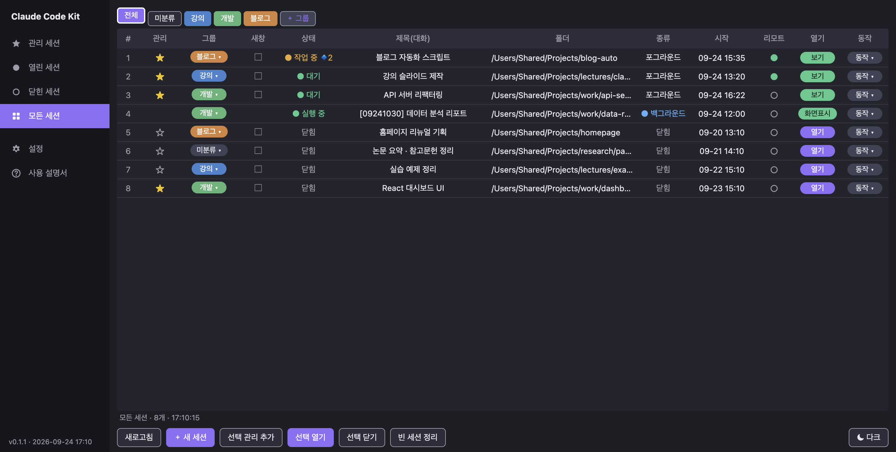

### 🖱️ 우클릭 메뉴
세션 행을 **우클릭**하면 그 세션으로 할 수 있는 것이 전부 그룹으로 모여 뜹니다. 지금 상태에 맞는 항목만 나옵니다(리모트가 켜져 있으면 "리모트 끄기", 관리 세션이면 "관리 제거").

- **정보** - 상세 정보, 세션ID 복사
- **탐색** - 터미널 창 앞으로, 폴더 열기, 이름 바꾸기
- **그룹** - 그룹 지정 · **타사 API 설정 `[지금 적용된 것]`** ([아래](#-타사-api-설정-베타---openrouter-키로-다른-회사-모델-쓰기) 참고)
- **상태 전환** - 세션 재시작(닫고 바로 다시 열기) · 리모트 켜기/끄기 · 관리 추가/제거 · bg 전환
- **닫기/삭제** - 아래쪽에 따로 구분

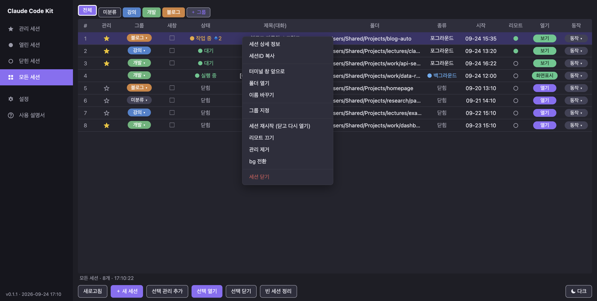

### ➕ 새 세션
하단 **`＋ 새 세션`** → 폴더 선택 + 세션명 + 그룹 + **원격 연결** + 관리 추가. 새 폴더의 "이 폴더를 신뢰?" 물음은 자동으로 통과합니다.
원격 연결을 체크하면 세션이 뜨는 대로 리모트까지 켜고, 적용하지 못한 것이 있으면 알려 줍니다.
**타사 API 프로필**을 고르면 세션을 열기 전에 그 폴더에 적용해 처음부터 그 모델로 엽니다 (기본 = 사용 안 함, 클로드 모델).

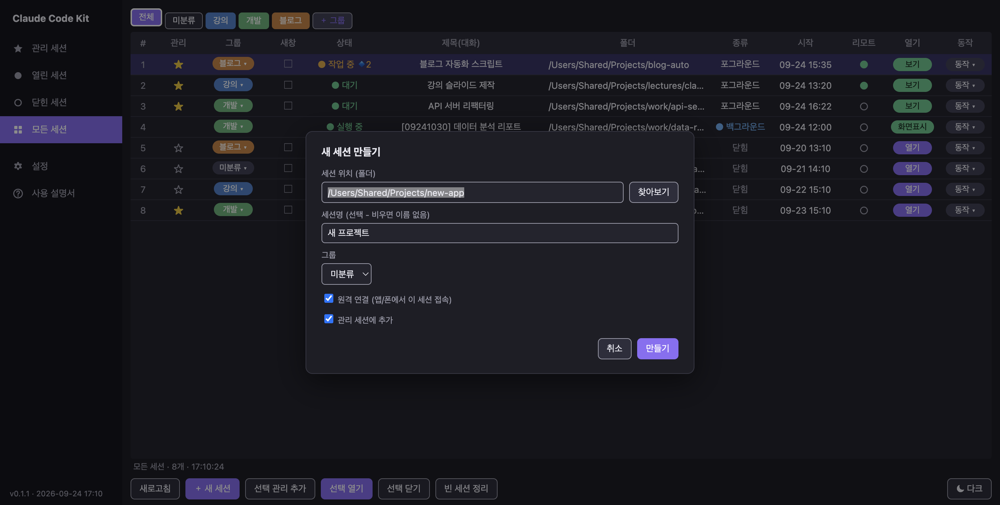

### 🌙 bg 전환
실행 중 세션을 백그라운드로 보냅니다. 터미널 창은 닫히고 세션은 계속 실행 - 이름 앞에 `[MMddHHmm]` 시각이 붙고, 리모트가 켜져 있었으면 백그라운드에서도 이어받습니다.
**화면표시**로 언제든 다시 보고, **화면닫기**로 창만 닫아도 계속 돕니다.

### 📱 리모트 컨트롤 - 폰/웹에서 이 Mac 조종
세션의 **리모트**를 켜면 `/remote-control` 이 실행돼, **claude.ai/code 또는 모바일 Claude 앱**에서 그 세션이 그대로 보이고 조종됩니다.

1. 패널에서 세션의 **리모트 ○** 를 누름 → 2. "리모트를 켰습니다" → 3. 패널에 **● 켜짐** → 4. **claude.ai/code(웹/앱)에서 그 세션 조종**

- 처음 켤 때 claude 가 묻는 동의 질문도 자동으로 통과합니다.
- **닫힌 세션**의 리모트를 누르면 세션을 열고 바로 리모트를 켭니다.
- 켜짐/꺼짐은 세션의 실제 상태로 확인해 표시합니다.
- 설정의 **절전 방지**를 켜 두면 잠자기로 끊기지 않고, **리모트 유휴 유지**가 오래 쉰 세션을 다시 연결해 둡니다.
- 입력칸에 **보내지 않은 글자가 있으면** 섞여서 전송되지 않도록 명령을 넣지 않고 알려 줍니다.

### 🔹 서브에이전트 표시
세션이 Task/Agent 를 돌리면 상태칸에 **`🔹N`** 뱃지 → 클릭하면 작업 중인 서브에이전트 목록 팝업 (끝나면 자동으로 사라짐).

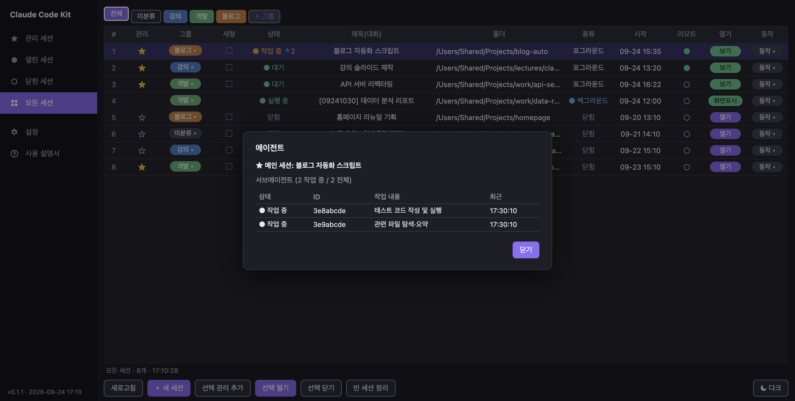

### ★ 관리 세션 / 이어서 열기 · 🏷️ 그룹
자주 쓰는 세션을 **관리(★ 금색 별)** 에 담아두면 닫혀도 '관리 세션' 탭에 남습니다. **`전체 이어서 열기`** 한 번이면 열어뒀던 폴더에서 대화까지 이어서 한꺼번에 다시 엽니다.

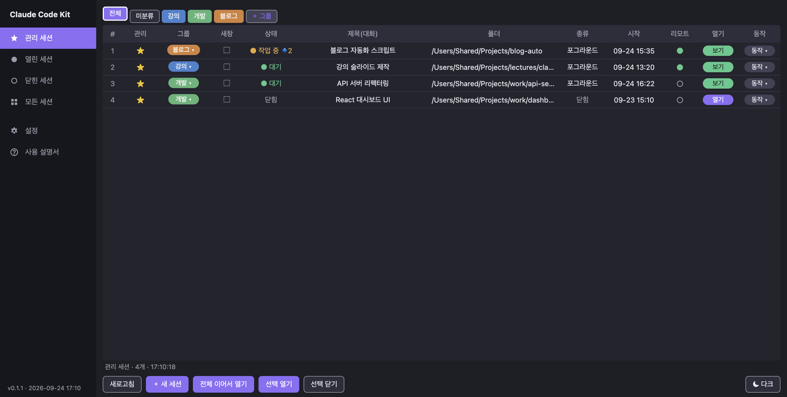

**그룹**으로 세션을 묶고(`＋ 그룹`, 그룹 칸 클릭), 위쪽 탭으로 걸러 봅니다. 탭은 끌어서 순서를 바꾸고, 우클릭으로 이름 변경·삭제.

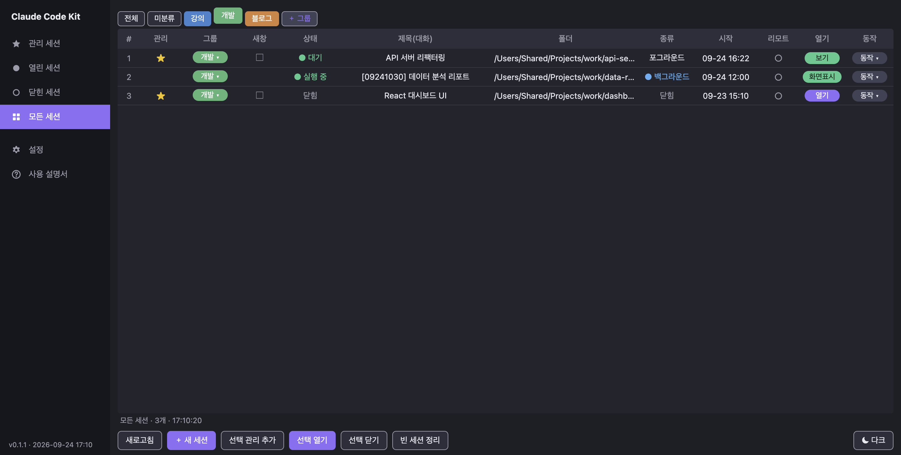

### 🗓️ 세션 보관 기간 · 기간만료
Claude Code 는 **보관 기간(기본 30일)이 지난 세션의 대화 파일을 스스로 지웁니다.** 관리에 담아 둔 세션이 어느 날 "대화가 없다"며 안 열리는 이유가 이것입니다. CCKit 은 이걸 구분해서 보여주고, 보관 기간을 바로 바꿀 수 있게 합니다.

- **닫힌 세션 · 모든 세션 · 관리 세션** 탭에서 대화 파일이 사라진 관리 세션의 상태 칸이 빨간 글씨로 나옵니다.
  - **기간만료** - 보관 기간이 지나 Claude Code 가 지운 것. 누르면 설정의 보관 기간 칸으로 갑니다.
  - **대화없음** - 보관 기간과 상관없이 CCKit 밖에서 사라진 것. 폴더도 없으면 폴더 칸까지 빨갛게 나옵니다.
- 닫힌 세션의 상태 칸에는 **닫은 시각**(`닫힘 10-27 12:53`)이 나오고, 최근에 닫은 순으로 정렬됩니다.

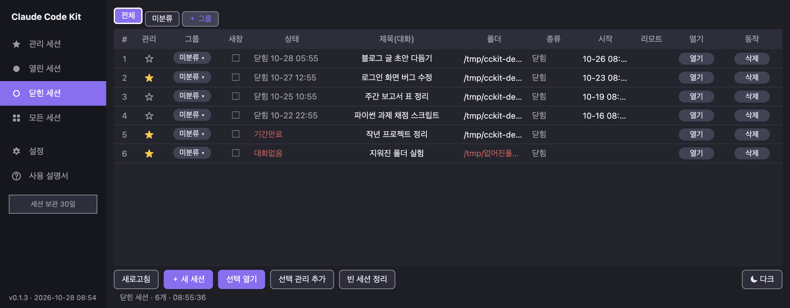

- 관리 세션 탭에서도 같은 표시가 나옵니다. 왼쪽 아래 **`세션 보관 30일`** 박스는 지금 보관 기간이며, 누르면 설정으로 갑니다.

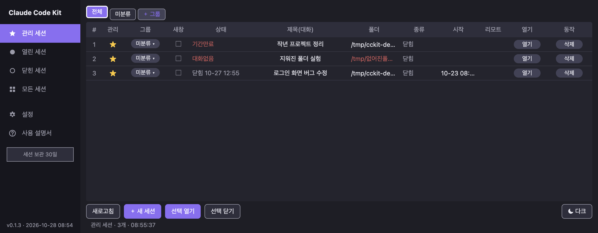

- **설정 → 세션 보관 기간 (Claude Code)** 에서 일수를 바꾸면 바로 `~/.claude/settings.json` 의 `cleanupPeriodDays` 에 저장됩니다. 다른 설정은 그대로 둡니다.
- 일수를 늘리면 **앞으로** 지워지는 것만 막습니다. 이미 지워진 대화는 되살릴 수 없으므로 계속 `기간만료` 로 표시합니다.

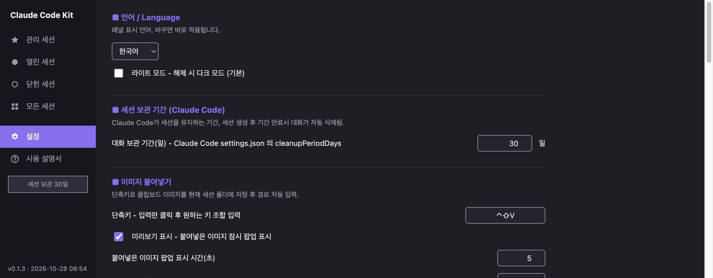

### 🔑 로그인 확인 - 구독 로그인이 안 될 때
예전에 `ANTHROPIC_API_KEY` 를 넣어 둔 채 구독(Claude.ai) 로그인을 하면, **Claude Code 는 키를 우선 씁니다.** 그 키가 만료·무효면 로그인을 몇 번 해도 계속 막힙니다. 왼쪽 메뉴 맨 아래 **로그인 확인** 화면에서 키가 어디에 남아 있는지 보고 바로 비울 수 있습니다.

- 키가 설정될 수 있는 세 곳을 **한 줄씩 따로** 보여 줍니다 (우선순위 순). 설정 안 됨 = 초록, 설정됨 = 주황, 키는 앞뒤만 보이게 가립니다.
  - **OS 환경변수** - 셸 설정 파일(`~/.zshrc`·`~/.zprofile`·`~/.bash_profile` 등)의 `export ANTHROPIC_API_KEY=…` 와 `launchctl setenv`. 어느 파일 몇째 줄인지도 보여 줍니다.
    **비우기** 를 누르면 그 파일을 먼저 백업(`.cckit-backup-날짜`)한 뒤 그 줄을 지우지 않고 주석으로 바꿉니다. 이미 열린 터미널에는 남아 있으니 새 터미널부터 반영됩니다.
  - **settings.json env** - `~/.claude/settings.json` 의 `env.ANTHROPIC_API_KEY`. 입력칸에 넣고 **저장** 하면 새로 여는 세션부터 반영됩니다.
  - **settings.json apiKeyHelper** - `"apiKeyHelper": "echo 키"` 형태로 저장합니다. 세션을 다시 열지 않아도 **바로 반영**됩니다.
- 저장·비우기는 settings.json 의 **그 키 하나만** 바꾸고 다른 설정은 그대로 둡니다. 파일이 깨져 있으면 덮어쓰지 않습니다. 비우기는 확인 창을 한 번 거칩니다.
- 저장하면 진행 막대가 있는 안내로 **어디에 저장했는지와 언제 반영되는지** 알려 줍니다.

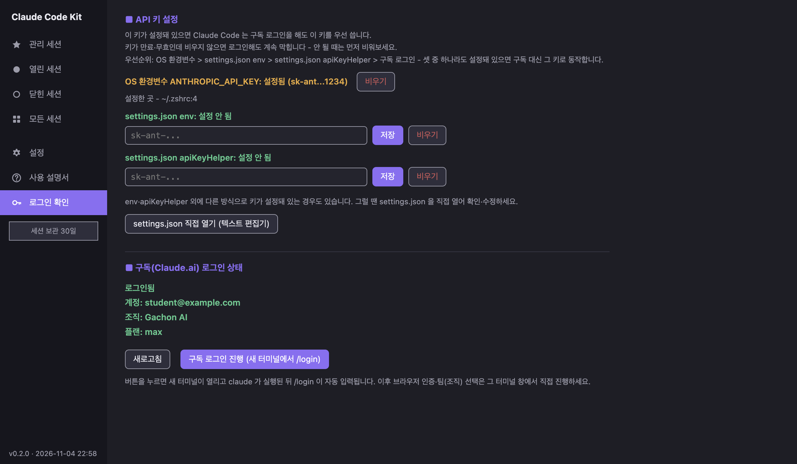<br>
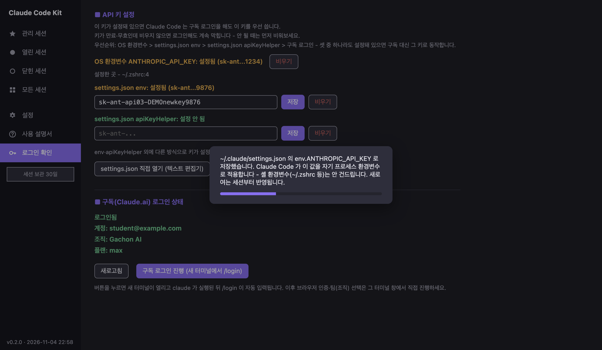

- **구독(Claude.ai) 로그인 상태** - 로그인됨 / 로그인 만료됨 / 로그인 안 됨과 계정·조직·플랜을 보여 줍니다. Mac 의 Claude Code 는 로그인 정보를 키체인에 두므로 `claude auth status` 로 확인합니다 (CCKit 은 키체인 비밀값을 읽지 않습니다).
- **구독 로그인 진행 (새 터미널에서 /login)** - 새 Terminal 창에서 claude 를 띄우고 `/login` 을 자동으로 입력합니다. 로그인 방법(1번 = 구독 계정)·브라우저 인증·팀 선택은 그 창에서 직접 하세요.
  로그인이 끝나면 **그 임시 창은 몇 초 안에 저절로 닫히고**, 세션 목록에도 남지 않습니다.

### 🌐 타사 API 설정 (베타) - OpenRouter 키로 다른 회사 모델 쓰기
Claude 구독 대신 **[OpenRouter](https://openrouter.ai) 키**로 다른 회사 모델(예: `openai/gpt-5.6-luna`)을 Claude Code 에서 씁니다.
**반드시 폴더(프로젝트)별로만** 적용합니다 - 그 세션 폴더의 `.claude/settings.local.json` 에만 쓰고, **전역 `~/.claude/settings.json` · OS 환경변수(`~/.zshrc` 등)는 절대 건드리지 않습니다.** 다른 프로젝트는 그대로 클로드 모델로 돕니다.

**쓰는 순서**
1. [openrouter.ai](https://openrouter.ai) 에서 키를 만듭니다 (`sk-or-v1-...`, 크레딧 충전 필요).
2. 왼쪽 메뉴 **타사 API 설정** → 맨 위 입력 줄에 **이름 · 모델 · API 키** 를 넣고 **추가**.
   - **모델** 칸은 OpenRouter 공개 모델 목록(약 470개)에서 **일부만 쳐도 찾습니다** (`luna`, `gemini`, `claude` … 대소문자 무관, 중간 글자도 됨). `↑↓` 로 고르고 `Enter` 확정, `Esc` 닫기.
   - 프로필은 **번호(#)** 로 관리합니다. **수정** 을 누르면 입력 줄로 불러와 고친 뒤 **저장** - 이름을 바꿔도 같은 프로필이 고쳐집니다.
3. 세션 목록에서 세션 **우클릭 → 타사 API 설정 `[지금 적용된 것]`** → 프로필 선택. 지금 적용된 것에 ✓ 가 붙습니다.
   - 새로 만들 세션이면 **＋ 새 세션** 창의 **타사 API 프로필** 칸에서 고르면 됩니다 (리모트는 쓸 수 없어 원격 연결 체크를 꺼 줍니다).
4. 그 폴더에 **열려 있는 세션**이 있으면 "지금 재시작할까요? (대화는 이어집니다)" 를 묻습니다. **예** = 닫고 `--resume` 으로 다시 열어 바로 그 모델로 이어집니다.
5. 해제 = 우클릭 → 타사 API 설정 → **사용 안 함 (클로드 모델)**. 타사 API 탭에서 프로필을 누르면 **그 프로필이 적용된 세션**이 아래 표에 나오고, **선택 세션에서 해제** 로도 풀 수 있습니다.

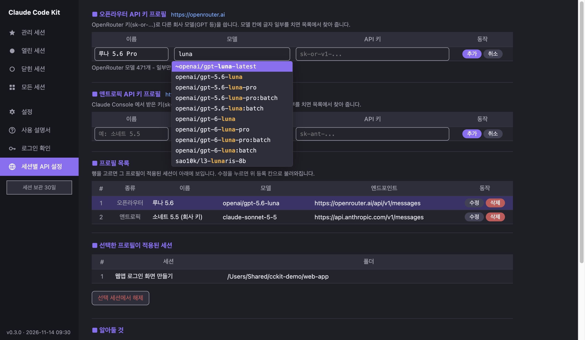<br>
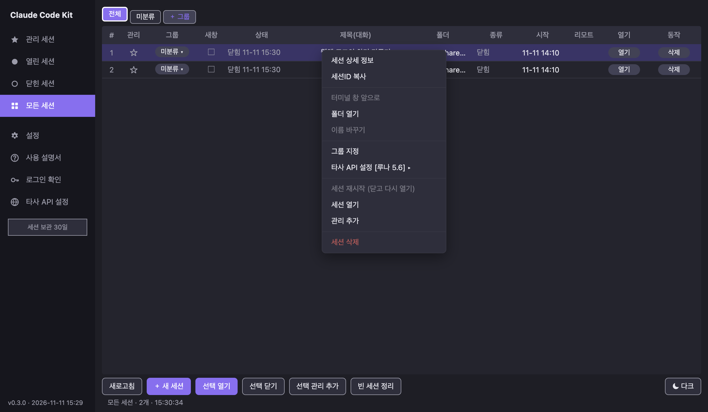<br>
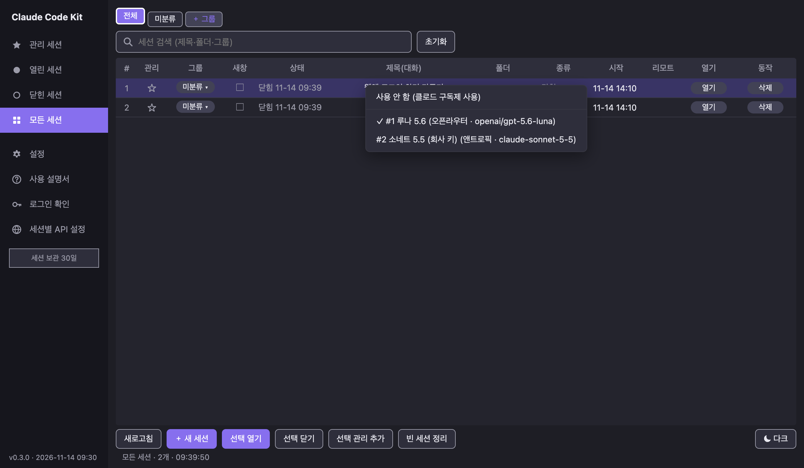<br>
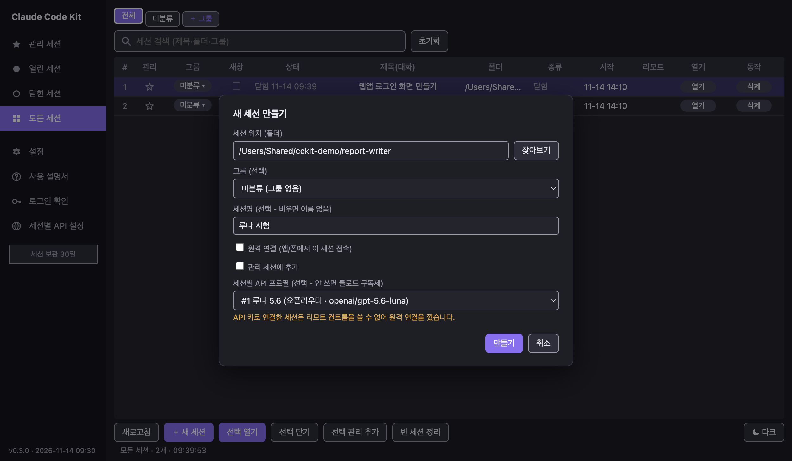

**실제로 들어가는 값** (`<세션 폴더>/.claude/settings.local.json` - [OpenRouter 공식 Claude Code 연동 방식](https://openrouter.ai/docs/guides/coding-agents/claude-code-integration))
```json
{
  "env": {
    "ANTHROPIC_BASE_URL": "https://openrouter.ai/api",
    "ANTHROPIC_AUTH_TOKEN": "sk-or-v1-...",
    "ANTHROPIC_API_KEY": "",
    "ANTHROPIC_DEFAULT_OPUS_MODEL": "openai/gpt-5.6-luna",
    "ANTHROPIC_DEFAULT_SONNET_MODEL": "openai/gpt-5.6-luna",
    "ANTHROPIC_DEFAULT_HAIKU_MODEL": "openai/gpt-5.6-luna"
  }
}
```
- 주소는 **짧은 `https://openrouter.ai/api`** 만 넣습니다. Claude Code 가 뒤에 `/v1/messages` 를 스스로 붙입니다 (전체 주소를 넣으면 `/v1/messages/v1/messages` 가 되어 404). 표의 엔드포인트 칸에는 실제로 부르는 `https://openrouter.ai/api/v1/messages` 를 보여 줍니다.
- 키는 `ANTHROPIC_AUTH_TOKEN` 에 넣고, `ANTHROPIC_API_KEY` 는 **빈 값으로 명시**해 다른 곳(셸 환경변수 등)에 남은 키가 먼저 쓰이는 것을 막습니다.
- 이 파일의 **다른 설정·다른 env 항목은 그대로** 두고 위 6개만 넣고 뺍니다. 해제하면 6개만 지우고, env 가 비면 env 항목도 지웁니다. 파일이 깨져 있으면 덮어쓰지 않습니다.
- 프로필 밖에서 손으로 넣은 값이 있으면 메뉴에 `[직접 설정됨 (모델)]` 과 회색 체크 줄로 보여 줍니다.

**이어 열기 모델 자동 보정** - Claude Code 는 이어 열면(`--resume`) 대화 기록의 **마지막 응답 모델을 그대로** 씁니다. 그래서 해제한 뒤 그냥 이어 열면 `openai/gpt-5.6-luna` 가 남아 "There's an issue with the selected model" 오류가 납니다. CCKit 은 이어 열 때 기록의 모델과 지금 폴더 설정을 비교해 맞춰 엽니다.
- 폴더에 타사 설정이 있고 기록 모델과 다르면 → `--model <프로필 모델>`
- 폴더에 타사 설정이 없는데 기록 모델이 타사 ID(`/` 포함)면 → `--model default` (클로드 기본 모델)
- 그 외는 그대로

**키 보안** - 키는 그 폴더의 `settings.local.json` 에 평문으로 들어갑니다. **git 저장소 폴더면 `.gitignore` 에 `.claude/settings.local.json` 줄이 없을 때 자동으로 추가**해 키가 커밋되지 않게 합니다. 프로필(키 포함)은 `~/Library/Application Support/CCKit/thirdparty.json` 에 저장됩니다.

**알아둘 한계**
- 키로 연결한 세션은 **claude.ai 계정 기능(Artifact · Docs · 리모트 컨트롤 · 커넥터)을 쓸 수 없습니다** - `/remote-control` 은 `Unknown command` 로 나옵니다. **Anthropic API 키로 연결해도 같습니다.** 로컬 스킬·파일 작업은 그대로 됩니다.
- **OpenAI 키(`sk-proj-...`)는 쓸 수 없습니다.** Claude Code 는 Anthropic 방식 주소(`/v1/messages`)를 부르는데, `api.openai.com` 에는 그 주소가 없어 404, OpenRouter 주소에 OpenAI 키를 넣으면 401 이 납니다. OpenRouter 키를 쓰세요 (OpenAI 모델도 OpenRouter 로 씁니다). OpenRouter 키가 아니면 저장 전에 한 번 더 묻습니다.
- 설정은 **폴더 단위**라 그 폴더에서 연 세션이 전부 같은 모델을 씁니다. 사용 요금은 OpenRouter 크레딧에서 나갑니다.

### 📋 상세 정보 · ⚙ 설정 · 메뉴바

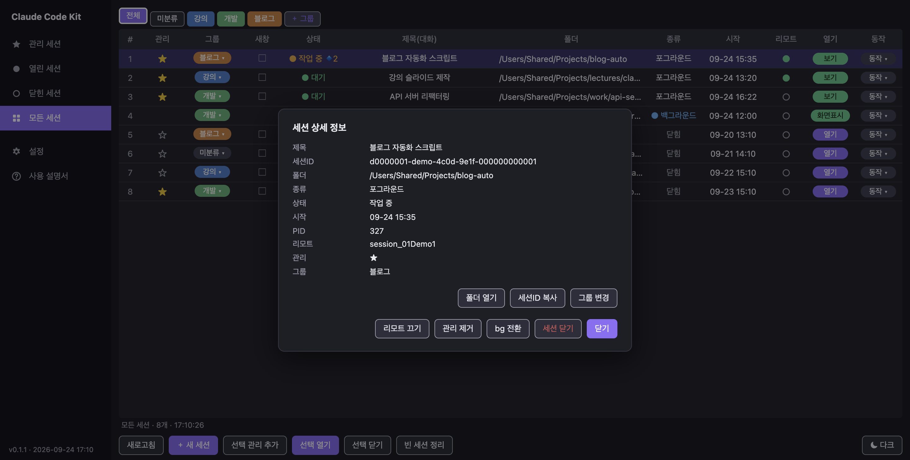<br>
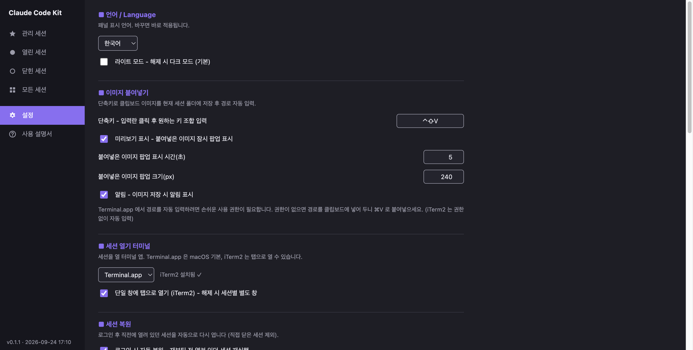<br>
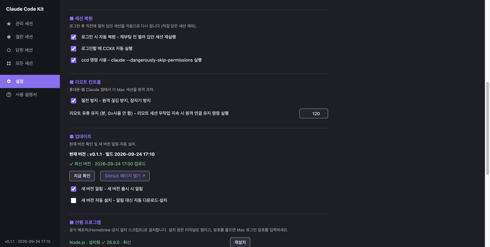

- **상세 정보**(상태칸 더블클릭): 경로/세션ID 확인·복사 + 폴더 열기·그룹 변경 + 그 세션의 모든 동작
- **설정:** 언어(한/영/일/중) · 라이트/다크 · 이미지 붙여넣기(단축키·미리보기·알림) · 터미널(Terminal.app / iTerm2, 탭 모드) ·
  로그인 시 자동 실행/자동 복원 · ccd · 절전 방지 · 리모트 유휴 유지 · 업데이트(알림/자동 설치) · 선행 프로그램 · 전체 초기화
- **메뉴바 ✦ 메뉴:**
  ```
  컨트롤 패널
  ──────────
  세션 이어서 열기  ▸  (관리 세션 목록 · 관리 세션 이어서 열기 · 현재 세션 저장 · 관리 세션에서 제거)
  열린 세션         ▸  (누르면 그 터미널 창 앞으로)
  ──────────
  설정 · 사용법 · 업데이트 확인 · 다시 시작
  ──────────
  종료
  ```

### 📖 사용 설명서
패널 왼쪽 **? 사용 설명서** (또는 메뉴바 → 사용법) - 4개 언어.

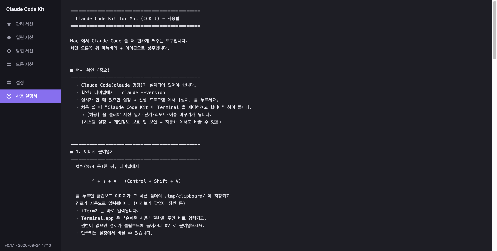

### 🔄 재부팅 자동 복원
설정에서 켜두면 **재부팅 직전 열려 있던 세션들을 로그인할 때 자동으로 다시** 엽니다. (로그인 항목에 자동 등록)

### ⌨️ ccd 단축 명령
```
ccd = claude --dangerously-skip-permissions
```
어느 폴더에서든 `ccd` 만 치면 **권한 확인을 건너뛰고(bypass permissions on)** 바로 Claude Code 가 실행됩니다.

```
$ ccd
 ▐▛███▜▌   Claude Code
 ...
  ⏵⏵ bypass permissions on (shift+tab to cycle)
```

**설정 → 세션 복원 → `ccd 명령 사용`** 체크로 설치/해제합니다 (`~/.local/bin/ccd`).

---

## 📋 요구사항
- **macOS 12 이상** (Apple Silicon · Intel)
- **Terminal.app**(기본) 또는 **iTerm2**
- **Claude Code CLI** - 없으면 설정 → 선행 프로그램에서 설치
- 리모트 컨트롤은 Claude 구독(Pro · Max · Team · Enterprise) 계정 로그인 필요

## 🗑️ 삭제
```bash
curl -fsSL https://github.com/hull-kr/Claude-Code-Kit-Mac/releases/latest/download/uninstall.sh | bash
```
- 지우는 것: 앱, CCKit 설정·데이터(`~/Library/Application Support/CCKit`), 로그인 항목, CCKit 이 만든 `ccd` 명령, 이 앱의 macOS 권한 기록
- 세션·대화 기록(`~/.claude`)은 Claude Code 의 것이라 **건드리지 않습니다.**

## 📄 라이선스 / 제작
- **제작:** [hull.kr](https://hull.kr) · **문의:** kimkap10@gmail.com
- **무료 자유 소프트웨어(Freeware)** - 자유롭게 받아 쓰세요. Apple 개발자 서명·공증은 하지 않았습니다.
- © 2026 hull.kr
